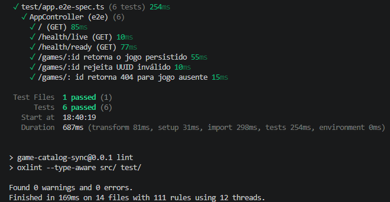

# Game Catalog Sync

Projeto pessoal de aprendizado e portfólio de um backend para catálogo de jogos.

[English](README.md)

## Evidências

### Testes de integração HTTP

Captura histórica: seis testes HTTP passaram, cobrindo os endpoints de saúde e as respostas
200, 400 e 404 do catálogo. Os cenários de banco usam PostgreSQL isolado.
Lint concluído sem avisos ou erros.



## Estado atual

Implementado e verificado localmente:

- NestJS e TypeScript usando ES modules.
- PostgreSQL 17.11 e Prisma 7.10.0, com migrações de Game e User.
- Usuários separados para aplicação e migrações.
- Fixtures e seed repetível com três jogos sintéticos e dois usuários de demonstração.
- POST /auth/login com email normalizado, verificação de senha com scrypt,
  erro 401 genérico e JWT HS256 válido por 15 minutos.
- Login aceita somente email e password; resposta contém apenas access_token
  e inclui Cache-Control: no-store.
- Limite do login: cinco requisições por minuto por IP, com 429 e Retry-After;
  uma verificação de credenciais por vez por instância do serviço.
- Guard Bearer JWT registrado e exportado pelo AuthModule. Testes HTTP em
  rota exclusiva de teste aceitam token válido e retornam 401 para token
  ausente, malformado, expirado ou adulterado, identidade ou papel inválidos
  e emissor, destinatário ou algoritmo inesperados. As rotas funcionais
  ainda não usam o guard.
- AdminGuard consulta o papel atual no banco após autenticação JWT.
  Testes HTTP em rota exclusiva de teste cobrem 401 sem autenticação ou
  para usuário removido, 403 para USER, acesso ADMIN, rebaixamento com o
  mesmo token e 503 durante falha do banco, com recuperação posterior.
- API com escuta explicitamente restrita a 127.0.0.1.
- GET /games com paginação por cursor UUID, ordem crescente por id,
  limite padrão 20 e máximo 100. Resposta com items e nextCursor.
- GET /games/:id: 200 para jogo existente, 404 para ausente
  e 400 para UUID inválido.
- Indisponibilidade do banco no catálogo: Prisma P1001 retorna 503.
- GET /health/live e GET /health/ready, com falha e recuperação
  verificadas manualmente.
- Nove testes unitários e dezoito e2e, com PostgreSQL real em banco isolado
  nos cenários de banco. Cobrem paginação, constraints de User, respostas HTTP
  do login, limite de requisições, verificação de token, rejeição de tokens
  expirados ou adulterados, falha/recuperação do banco e fechamento
  da conexão após app.close().
- Build e lint verificados.

Aplicação dos guards às rotas funcionais, avaliações,
Redis, sincronização em background,
CI e deploy cloud ainda não foram implementados.

## Ambiente local

Verificado no Ubuntu 24.04.4 via WSL, com Node.js 24.16.0 e npm 11.13.0.

As dependências estão registradas em `package-lock.json`.

## Configuração e execução

Na raiz do projeto:

```bash
npm ci
```

A aplicação requer PostgreSQL, DATABASE_URL e JWT_SECRET.
O Compose disponibiliza o banco de desenvolvimento em 127.0.0.1:5436
e, pelo perfil test, o banco de testes em 127.0.0.1:5437.

A preparação dos usuários, schema e permissões do banco de desenvolvimento
ainda é manual. Iniciar somente o Compose não conclui esse setup.
As instruções completas dessa preparação ainda estão pendentes.

O banco de testes possui preparação automática, descrita em Verificação.

Variáveis locais usadas:

- POSTGRES_ADMIN_PASSWORD: senha administrativa do banco de desenvolvimento.
- DATABASE_URL: conexão da aplicação com o usuário limitado.
- MIGRATION_DATABASE_URL: conexão do usuário de migrações.
- SHADOW_DATABASE_URL: conexão com o banco shadow separado.
- JWT_SECRET: 64 caracteres hexadecimais minúsculos gerados a partir de
  32 bytes aleatórios; obrigatório na inicialização, sem valor padrão.
- DEMO_USER_PASSWORD: senha sintética de user@example.test (somente seed).
- DEMO_ADMIN_PASSWORD: senha sintética diferente de admin@example.test
  (somente seed). Cada senha exige pelo menos 15 caracteres e no máximo
  1024 bytes em UTF-8. Não use credenciais pessoais.
- POSTGRES_TEST_ADMIN_PASSWORD: senha administrativa do banco de testes.
- TEST_DATABASE_URL: conexão do usuário limitado de testes.
- TEST_MIGRATION_DATABASE_URL: conexão administrativa para migrações de teste.
- POSTGRES_TEST_APP_PASSWORD: senha original do usuário limitado de testes;
  deve corresponder à senha de TEST_DATABASE_URL, antes da codificação na URL.

Credenciais ficam no .env, ignorado pelo Git.
Nunca use a mesma URL para o banco principal e o shadow database.

O client gerado também é ignorado pelo Git. Após npm ci, gere-o:

```bash
npx --no-install prisma generate
```

Após preparar o banco de desenvolvimento e aplicar as duas migrações,
configure as senhas de demonstração e execute:

```bash
npm run build
node prisma/seed.mjs
```

O seed confere a identidade do banco da aplicação e cria
user@example.test (USER) e admin@example.test (ADMIN) com hashes scrypt.
Repetições preservam jogos, senhas e papéis existentes. Alterar uma senha
do seed no .env não rotaciona a credencial armazenada; a verificação falha
se a senha configurada ou o papel esperado divergir do registro persistido.

A API escuta em 127.0.0.1, na porta 3000 por padrão; PORT permite alterar a porta.
Confira se a porta está disponível:

```bash
ss -ltn 'sport = :3000'
```

Após preparar e iniciar o banco, inicie a API:

```bash
npm run start:dev
```

Com a API ativa, execute em outro terminal:

```bash
curl -i http://localhost:3000/health/live
curl -i http://localhost:3000/health/ready
```

Com o banco disponível, ambos retornam HTTP 200 e {"status":"ok"}.
Se a consulta ao banco falhar, readiness retorna 503;
liveness permanece independente dessa consulta.

Encerre a API com Ctrl+C.

## Verificação

Com as variáveis de teste configuradas no .env, execute:

```bash
npm run test:db:prepare
npm test
npm run test:e2e
npm run build
npm run lint
```

A preparação inicia somente db-test, cria o usuário limitado, schema
e permissões na inicialização de um banco vazio e aplica as migrações.

db-test usa tmpfs e perde seus dados ao parar. Execute novamente
npm run test:db:prepare antes dos testes após cada parada.

A última regressão e2e aprovou dezoito testes em oito arquivos;
build e lint também passaram para as alterações do guard administrativo. Os nove testes
unitários passaram no marco anterior de login e não foram repetidos nesta etapa.
Os testes de falha/recuperação recriam somente
db-test e reaplicam as duas migrações. O setup e2e gera um segredo JWT
temporário em vez de usar o segredo de desenvolvimento.

## Estrutura atual

- `src/health/`: endpoints de liveness e readiness do banco.
- `src/games/`: consulta por ID, listagem paginada e validação do limite.
- `src/auth/`: controller de login, validação, hash de senha, opções JWT
  e serviço de autenticação, além dos guards Bearer JWT e administrativo.
- `src/prisma/`: serviço e módulo de acesso ao banco.
- `src/app.module.ts`: módulo raiz.
- `src/main.ts`: ponto de entrada da aplicação.
- `prisma/`: schema, migrações, fixtures sintéticas e seed.
- `test/`: testes de integração HTTP e de serviço e validação do ambiente.

O endpoint inicial `GET /` ainda retorna `Hello World!`.

## Limitações e próximas etapas

O projeto é destinado ao desenvolvimento local.
O login emite tokens, e ambos os guards estão disponíveis e testados em
rotas exclusivas de teste. As rotas funcionais continuam públicas e não
aplicam autorização USER/ADMIN. JwtAuthGuard valida as claims sem consultar
o banco; AdminGuard também consulta a existência do usuário e seu papel atual.
O teste de falha/recuperação administrativa confirma 503 durante a parada
e 401 após a restauração para usuário removido; não demonstra uma operação
administrativa bem-sucedida após a recuperação.
Refresh tokens e revogação não foram implementados.
O contador do limite de requisições fica na memória de cada processo e
reinicia com a aplicação; não é compartilhado entre instâncias.
A liberação após o intervalo e o isolamento entre diferentes IPs
ainda não foram testados.

Liveness não consulta dependências; readiness consulta PostgreSQL.
Na consulta de jogos, somente Prisma P1001 é convertido em HTTP 503.
O serviço de autenticação também converte o encerramento administrativo
de conexão observado como P2039/57P01 em 503. Falha e recuperação da
autenticação foram testadas no serviço; a resposta HTTP do login durante
indisponibilidade ainda não foi testada separadamente.

A preparação do banco de desenvolvimento ainda é manual. O setup a partir de um clone novo
ainda não foi completamente documentado ou verificado.
O teste de falha e recuperação interrompe e recria somente db-test.
Ele descarta os dados desse banco e não deve executar simultaneamente
com outras suítes que dependam da mesma instância.

O encerramento explícito por app.close() foi verificado.
O encerramento por sinais do sistema, como Ctrl+C, ainda não foi validado.
Os arquivos e2e são executados sem paralelismo entre si.

O cursor é um UUID usado como limite exclusivo: id > cursor.
Um UUID válido não precisa corresponder a um jogo existente.
A paginação não mantém um snapshot entre requisições; a ausência
de repetição foi verificada em dataset estável.

Próximas etapas: avaliações com isolamento entre usuários e aplicação dos guards
às rotas funcionais,
seguidas de sincronização
em background e cache.
Busca, observabilidade e AWS ficam para depois.

## Assistência de IA

Implementei o projeto manualmente com orientação e sugestões de revisão
do Codex. Revisei o código e executei as verificações descritas neste
README. A revisão por IA não equivale a uma revisão independente.
